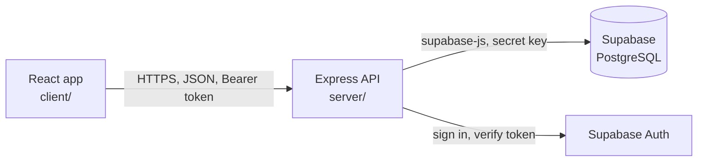
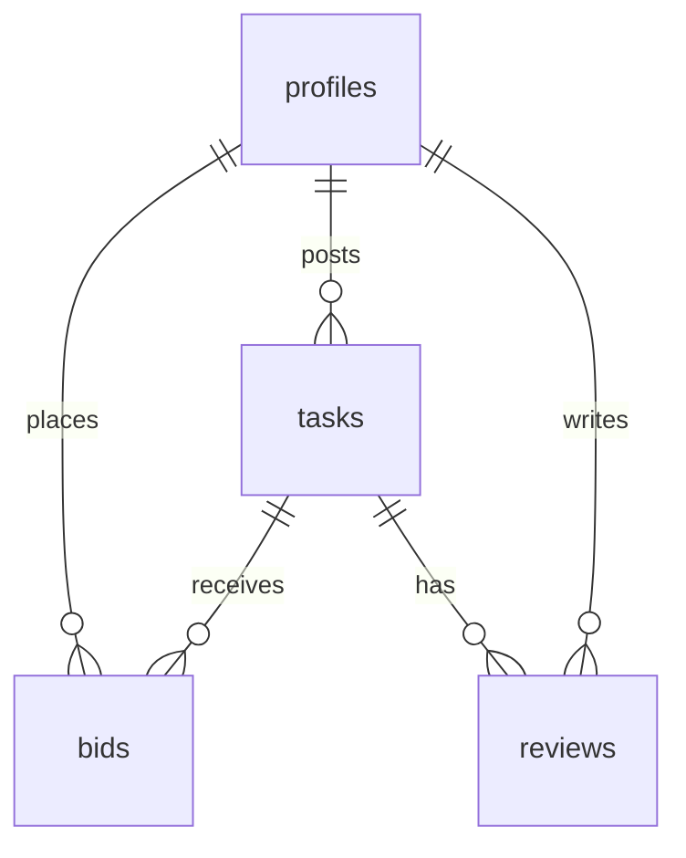
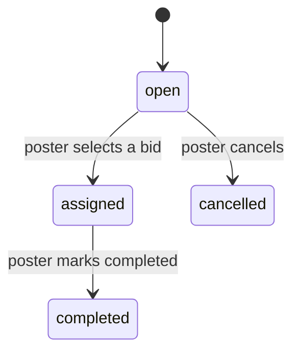

# Architecture

## The three layers



The browser never talks to Supabase and never holds a Supabase key.

## What happens on a request

Example: placing a bid, `POST /api/tasks/:id/bids`.

| Step | File                                            | Job                                            |
| ---- | ----------------------------------------------- | ---------------------------------------------- |
| 1    | `client/src/components/BidForm.jsx`             | Collects the form                              |
| 2    | `client/src/api/bids.js`, `client.js`           | Sends it with the access token                 |
| 3    | `server/routes/bidRoutes.js`                    | Picks the middleware and controller            |
| 4    | `server/middleware/auth.js`                     | Verifies the token                             |
| 5    | `server/middleware/validate.js` + `validators/` | Rejects bad input                              |
| 6    | `server/controllers/bidController.js`           | Reads the request, sends the reply             |
| 7    | `server/services/bidService.js`                 | Business logic and database calls              |
| 8    | `place_bid` in `server/db/schema.sql`           | Checks the rules and saves, in one transaction |

Errors from any step end in `middleware/errorHandler.js` and reach the browser as
`{ "error": { "message": "...", "details": [...] } }`.

## Folder map

```
server/
  index.js          starts the server (and is what Vercel imports)
  createApp.js      builds the Express app: security, CORS, routes, errors
  config/           environment variables, Supabase clients
  routes/           URL -> middleware -> controller
  middleware/       login check, validation, rate limit, error handling
  validators/       zod rules for every input
  controllers/      HTTP in and out
  services/         the actual features
  utils/            small helpers with no side effects
  db/               schema.sql, reset.sql, migrations/, seed.js, seedData.js
  tests/            unit tests and the end-to-end flow

client/src/
  main.jsx, App.jsx routes and page transitions
  api/              every call to the server
  context/          who is logged in, toast messages
  hooks/            useAsync, useForm, usePolling ...
  components/       reusable pieces (components/home/ for home sections)
  pages/            one file per screen
  lib/              formatting, constants, animation settings
  styles/           tokens, base, components, pages
```

## Data model



`profiles.id` is the same id as the Supabase `auth.users` row. Passwords are hashed and stored by
Supabase Auth, never in our tables.

## State rules



Bids start as `pending` and become `accepted` or `rejected`.

## Login with username, email or phone

Supabase Auth signs in with an email. At registration the server stores that email in
`profiles.auth_email`: the real one, or `91XXXXXXXXXX@phone.extask.app` for phone-only users.
At login it finds the profile by whatever was typed, then signs in with `auth_email`.
Phone-only users cannot reset a forgotten password by email (future scope).

## Security

- Row level security is on with no policies, and browser roles have no table or function grants.
- The secret key exists only in the server's environment.
- Every input is validated; unknown fields such as `id_verified` are dropped.
- Only listed profile columns are ever returned (`utils/serializers.js`).
- `helmet`, a CORS allow-list, a small body limit and a login rate limit.
- The same message is shown for a wrong password and an unknown account at login. (Registration
  does say when a username, email or phone is taken.)

Known limits: tokens are kept in `localStorage`; the rate limit is counted per server instance;
phone numbers and emails are not verified because there is no OTP or confirmation mail.

## How to change things

**Colours or fonts:** `client/src/styles/tokens.css` (and the font link in `client/index.html`).

**Animation speed:** `client/src/lib/motion.js`.

**Suggested categories:** `client/src/lib/constants.js`.

**Demo data:** `server/db/seedData.js`.

**Add a field, for example "tools needed" on a task:**

1. `server/db/migrations/002_task_tools.sql`: `alter table public.tasks add column tools text;`
   followed by `notify pgrst, 'reload schema';`. Run it in Supabase and add the column to
   `schema.sql` too.
2. `server/validators/taskValidators.js`: `tools: optionalText('Tools', 120),`
3. `server/services/taskService.js`: add `tools` to `TASK_COLUMNS`.
4. `client/src/pages/PostTask.jsx`: add `tools: ''` to the form and a `<FormField>`.
5. `client/src/pages/TaskDetail.jsx`: show it.

**Add a new feature (a new endpoint):** validator, service function, controller function, route,
then a function in `client/src/api/` and the page that uses it. Add a test.
